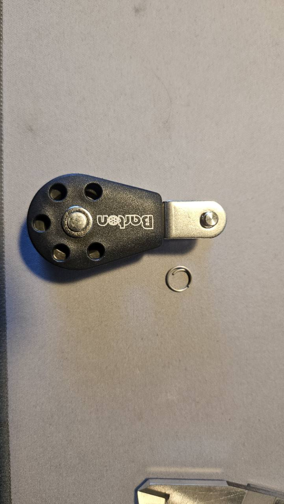
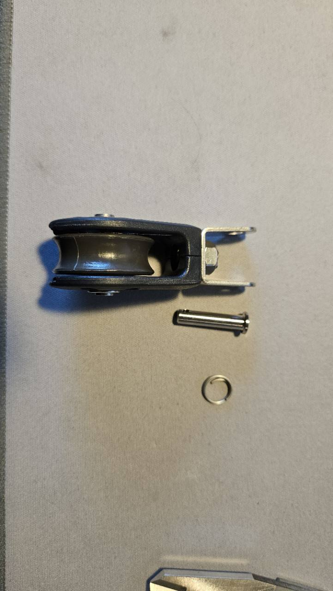

# Received Barton N01090 pulley: dimensions and reference CAD

11 October 2026. Owner-reported measurements and supplied photographs of the
received block. This supplements the [WASI purchase record](wasi-pulley-2026-10-08.md)
for the four already-collected BA01090 units; it changes neither purchase quantity
nor supplier price. Measurement instrument, uncertainty and serial/lot identifiers
were not supplied. Measurements describe the sampled part, not production tolerances.

## Identification and manufacturer specification

The [TCS listing](https://www.tcschandlery.co.uk/barton-single-fixed-eye-with-clevis-plain-bearing-series-1/p14889)
identifies **N01090**, Series 1 single fixed-eye double-tang/clevis, plain bearing.
Its illustration is identified as the ball-bearing version; the ordered article
is plain bearing. WASI uses SKU **BA01090** for the received same block.
The ball-bearing alternative **N11090** is a different article.

Primary references, accessed 11 October 2026:

- [Barton Series 1 double-tang product](https://bartonmarine.com/catalogue/size-1-30mm-plain-bearing-pulley-block-single-double-tang/).
- [Barton Series 1 range fact sheet](https://bartonmarine.com/wp-content/uploads/2024/04/Size-1-Block-range.pdf).
- [Barton catalogue issue 56](https://bartonmarine.com/wp-content/uploads/2025/10/Barton-Catalogue-issue-56-full-publication-1.pdf), printed pages 12–13 (PDF pages 14–15).

| Property | Specification / evidence |
| --- | --- |
| Sheave diameter × width | 30 × 12 mm, manufacturer |
| Maximum rope diameter | 8 mm, manufacturer; no minimum-diameter retention rating |
| Bearing | Plain: acetal sheave on brass bearing |
| Cheeks / load frame | Glass-reinforced nylon / internal stainless steel frame |
| Safe working load | 355 kg, manufacturer's block rating |
| Breaking load | 710 kg, manufacturer's block rating |
| Mass | 47 g in issue 56 catalogue; 48 g on product page, not weighed locally |
| Overall length | 65 mm in issue 56 catalogue, confirmed by owner |

Manufacturer web dimensions 66 × 32 × 25 mm conflict with the received sample.
The table below owns this sample's nominal reference CAD. No public supplier
manufacturing drawing, STEP or dimensioned 2D drawing was found in the product,
range-sheet and catalogue sources searched. The CAD is a reconstruction, not a
manufacturer-issued model. Block ratings do not establish ARBI assembly capacity.

## Owner measurements

| Measurement | Reported value | CAD axis / interpretation |
| --- | ---: | --- |
| Overall length | 65 mm | Z, bottom cheek to end of clevis |
| Maximum body width | 36 mm | X, in the side-cheek plane |
| Maximum thickness | 24 mm | Y, across the cheeks including axle heads |
| Supplied clevis-pin diameter | 4.7 mm | Y-axis attachment pin |
| Clear gap between tangs | 15.8 mm | Inner face to inner face along Y |
| Each metal tang thickness | 1.5 mm | Along Y; outer span 18.8 mm |
| Clevis-pin centre to sheave-axle centre | 42 mm | Centre to centre; replaces the initially misunderstood 4.5 mm response |

The pictures establish the double tang, supplied pin/ring, teardrop cheek and
five cheek openings. Perspective photographs do not define tolerances or the
remaining small dimensions.

## Canonical CAD and mating changes

[Shared reference geometry](../../hardware/lib/barton-size-1-block.scad) has its
origin at the sheave axle, +Z toward the clevis and Y along both pins. The
[registered pulley](../../hardware/assemblies/corner-station/top-positioning-line-pulley.scad)
is revision `1.0.0`, `concept-unvalidated`. The measured envelope and interface
are fixed; cheek profile/holes, axle/rivets, groove, pin usable length and retaining
ring are illustrative reconstructions. The [dimension diagram](../../docs/assets/barton-n01090-dimensions.svg)
shows the reported dimensions and provisional printed interface.

Both printed carrier halves must be reprinted at `1.0.0`: their combined central
rounded lug is **14.8 mm** thick, with **5.2 mm** bore. This provides provisional
0.5 mm clearance on each tang side and 0.5 mm diametral pin allowance. Inspect
the actual printed holes, usable pin length and ring engagement; do not enlarge
factory tang holes or substitute the old M8 pin. Other carrier pads, covers,
fasteners and WT-806 clamps retain their existing fabrication geometry.

The 42 mm centre spacing changes the equal-tension 45° block pose: attachment
pin offset becomes post radius +147.8515 mm passive /146.9515 mm powered; pin
Z165, sheave Z135.3015. The existing nominal winch tangent is preserved. Its
line-centre radius still assumes the catalogue outside diameter: actual groove
seating needs measurement and an installed alignment check.

The split-collar alternative now has the same central lug/native pin interface.
The standalone keeper is reworked around the 36 × 24 mm cheek envelope, with
1 mm radial/side allowance and side bridges that leave the clevis neck open.
It is a guard candidate, not an accepted thin-line keeper or fitted head part.
The steel-head connector remains a separate unqualified bought interface: its
M8 bracket side cannot be passed through the factory 4.7 mm tang holes.

See the [nominal geometry record](../../docs/assemblies/corner-station/barton-geometry-check.md)
and [acceptance record](../../docs/assemblies/corner-station/acceptance-record.md).
Groove root/side gaps, full articulation and fleet angle, ring locking, friction,
print dimensions/process, strength/creep, line retention and loaded operation
remain separate acceptance work.
