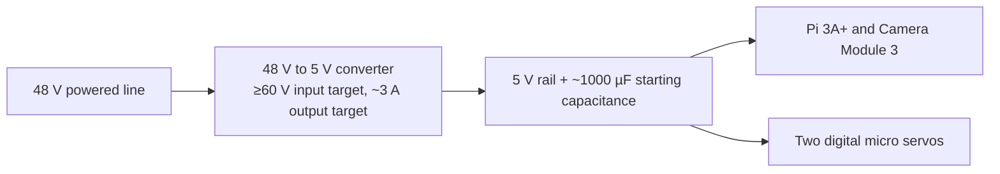

# Camera pod

## Responsibility and boundary

The camera pod is the only substantial moving assembly. It owns the four-line cable spider, fixed compute and power-electronics mounts, two-axis gimbal, camera, pod harness, optical/rain protection, docking stud, pod-side strain relief, pod software, mass properties, thermal behavior, and health reporting.

The [winches](../winch/README.md) own the positioning lines and line-side tensile/electrical terminations, following the shared [positioning-line specification](../positioning-lines/README.md). The pod owns the spider attachment hardware and electrical inlet. The [dock](../dock/README.md) owns the receiving funnel, latch, shelter, and parked-state sensor.

## V1 mass budget

| Component | Repository estimate | Notes |
| --- | ---: | --- |
| Raspberry Pi 3A+ | Approximately 29 g | Fixed to pod |
| Camera Module 3 Wide | Approximately 4 g | Moves with gimbal |
| 48 V to 5 V, approximately 3 A converter | Module-dependent | Fixed; at least 60 V input rating target |
| Approximately 1000 µF bulk capacitor | Module-dependent | Fixed near 5 V distribution |
| 2 × approximately 3.7 g digital servos | Approximately 7.4 g total | Moving gimbal actuators |
| Gimbal, horns, short wiring, and fasteners | Approximately 9–13 g | Moving mechanism |
| Pan/tilt addition subtotal | Approximately 16–20 g | Servos plus gimbal hardware |
| Printed spider/chassis | Approximately 15–25 g target | Fixed structural chassis |
| Short CSI ribbon, power wiring, and strain relief | Approximately 5–10 g | Interconnect |
| Rain cap and optical protection | Approximately 5–10 g target | Splash/direct-rain mitigation |
| Complete flying pod | **100–120 g target; 170 g hard design ceiling** | Must be measured as assembled |

The 170 g value is a ceiling, not a target. CAD mass estimates do not replace weighing the complete configured assembly. The owner-reported 103.05 g for earlier sliced printed parts has no independently confirmed installed quantities, print/support settings or actual printed mass; it is not an assembled-pod measurement.

## Mechanical arrangement

The cable spider is the primary chassis. Keep the Raspberry Pi 3A+, converter and capacitor fixed to it. The selected enclosed kit adds a one-piece outer head to the pan-moving carrier; the camera tilts inside it. This changes moving mass and inertia and requires renewed servo torque, current, horn/fastener load and settling checks. The component allowances above do not establish the revised head's mass or performance.

The design must define:

- line-attachment geometry and independent tensile terminations;
- center of gravity and its relationship to line plane and docking stud;
- docking stud above the center of gravity for pendulum-stable approach;
- fixed mounts, airflow, drainage, and service access;
- gimbal bearings/pivots, hard stops, horn attachment, backlash, and collision envelope;
- CSI ribbon bend radius and strain relief through the full gimbal range;
- secondary retention where a single small fastener could release a heavier part;
- safe optical opening and no water path into electronics.

## Gimbal and camera

The baseline is Camera Module 3 Wide with wide FOV and an IR-cut filter.
The [official geometry and electrical source review](../../../hardware/assemblies/camera-pod/raspberry-pi-camera-module-3/README.md)
records the manufacturer mechanical drawing, Wide STEP model, reference
schematic, sensor-assembly tolerances and CSI pinout, retrieved 12 October 2026.
It distinguishes the 12.0 mm drawing thickness from the rounded 12.4 mm product
envelope. ARBI's camera visualization and assembly references remain nominal;
the source model is shared with the booklet; physical mounting, focus and ribbon travel remain unverified.

V1 uses Raspberry Pi Camera Module 3 Wide, the 120° diagonal-field-of-view autofocus version. The baseline range is:

- pan: approximately ±90 degrees from its reference direction;
- tilt: 0 degrees straight down to approximately 70 degrees toward sideways.

Software limits must stop before the ribbon, cap, servo, camera board, or chassis binds. Hard geometry must also prevent a software error from tearing the ribbon or driving the mechanism into a damaging configuration.

The same camera is intended for whole-bed overviews, downward plant images, and selected oblique close-ups. Skycam X/Y positioning moves above the target first; gimbal motion refines framing after the pod stops. Future lower-Z close-ups are allowed only inside a separately validated crop and line-clearance envelope.

A 360-degree camera is excluded from V1 because most pixels would cover irrelevant directions and its mass is higher. A future higher-resolution autofocus module is a compatible design question, not part of V1.

## Pod power and electronics

The [Raspberry Pi 3A+ source and geometry review](../../../hardware/assemblies/camera-pod/raspberry-pi-3a-plus/README.md)
links the official board drawings, revision 1.0 reduced schematic and product
brief. The 65 × 56 mm board and 58 × 49 mm mounting pitch have published
provenance; board-hole diameter, thickness, full connector envelopes and actual
pod fit remain unverified.

The repository baseline feeds nominal 48 V through the powered positioning line and converts locally to 5 V:

The converter input/output ratings and capacitance are **starting targets**. Validate supply transients, input surge, maximum line voltage, voltage drop, current, efficiency, heat, brownout margin, servo stall/fault, Pi/camera capture load, Wi-Fi load, grounding, fusing, connectors, and capacitor temperature/ripple/lifetime.

The pod has no battery. It must start, stop, and recover deterministically when powered-line voltage is interrupted or marginal.

## Printed parts and fasteners

The [camera pod mount family](../../../hardware/assemblies/camera-pod/camera-pod-mounts.md) has canonical CAD and a [illustrated enclosure and dry bench booklets](booklet/README.md). It supplies the fixed electronics deck, servo mounts, supported camera cradle, removable pivot support, horn retainers, cover, hood and historical tie pads. The current compact kit replaces tie pads with removable retainers. The [7 October dry bench geometry checks](../../../hardware/assemblies/camera-pod/camera-pod-geometry-check.md) use provisional servo/power envelopes and apply to the revised r0.1.1 deck/yoke dry bench configuration; physical fits and the flying mass limit are not demonstrated.

The [integrated black/white enclosure](../../../hardware/assemblies/camera-pod/camera-pod-enclosure.md) uses a rounded white fixed hood, a separate compact carrier and a one-piece black moving head. The compact tilt axis stays at Y=3, Z=-45, with its horizontal servo 2 mm inboard. [Stock fastener proposal #225](fastener-standardization.md) updates assembly r0.4.0: deck/carrier/head/cradle/support r0.2.0 and rain hood r0.3.0 use M3 × 12/25 printed joints and M2 × 8 board joints. The deck integrates the four former spacers, giving 12 installed prints and 12 fabrication models including the optional coupon. Four M3 head clamps replace M2. The camera/white hood retain four M2 × 8 rear screws and four captive front nuts; no camera washers. PCB holes, electronics heights, tray r0.2.3, optical geometry and the neck seam are retained; hood r0.2.0 adds captive front nuts. Supported service and separate relaxed cable loops remain necessary.

The [reconciled Wide-camera record](../../evidence/camera-module-3-wide-2026-10-14.md) owns the prior hood r0.1.3, outer head r0.1.5 and assembly r0.3.10 checks: camera rear insertion, full-square module clearance, Wide optical volume, service and sampled motion pass. The [earlier compact-gimbal record](../../../hardware/assemblies/camera-pod/camera-pod-enclosure-check.md) remains evidence for its stated previous revisions. That prior configuration's sixteen installed prints total 251.734 g as a solid-volume PETG estimate at 1.27 g/cm³, excluding hardware and electronics. Sliced/printed and assembled mass, pan-servo torque/settling and rain protection of the camera and CSI loops remain unverified against the 170 g complete-pod ceiling and imaging targets. The stock fastener proposal requires fresh nominal CAD and physical reprint/hardware acceptance; those earlier records do not qualify its new captive posts or smaller frame screws.

The camera-pod concept family below remains available as a separate arrangement. Both families share the spider and remain **concept-unvalidated**; do not combine their gimbal or electronics mounts into one print kit. The bench set does not resolve the docking or load-rated line interfaces.

| Model | BOM part | Role |
| --- | --- | --- |
| `camera-pod-spider` | `camera-pod-chassis` | Four-line cable spider |
| `camera-pod-electronics-mount` | `camera-pod-chassis` | Pi and power-electronics mount |
| `camera-pod-docking-stud` | `camera-pod-chassis` | Docking stud |
| `camera-pod-line-strain-relief` | `camera-pod-chassis` | Hybrid-line strain relief (print 4) |
| `camera-gimbal-base`, `camera-gimbal-yoke`, `camera-gimbal-camera-plate` | `camera-gimbal` | Lightweight pan/tilt gimbal |
| `camera-gimbal-rain-cap` | `camera-gimbal` | Servo-body rain cap |
| `camera-gimbal-optical-hood` | `camera-gimbal` | Optical hood/protection |

See [camera pod OpenSCAD sources](../../../hardware/assemblies/camera-pod/README.md) for print counts, bolt-circle sandwich, and starting COTS envelopes. Compilation does not prove mass, fit, strength, or weather behavior.

ASA is preferred for exposed release parts. PETG is acceptable for prototypes pending creep and weather evidence. Each model still needs interface confirmation from measured hardware, material and print specification, expected mass, and test evidence. Small servo screws, horns, inserts, pivots, and camera fasteners must be documented with the same care as larger parts.

## Weather and environmental behavior

The micro servos are not waterproof. The dry cap and proposed integrated shell target reduced direct rain and splash; neither authorizes wet-weather operation. The shell retains open moving interfaces and downward drainage rather than a sealed servo chamber. Wiring must not channel water into a servo case, camera connector, or electronics. Drainage, condensation, UV, temperature, insects, fertilizer/chemical exposure, and contamination of the optical opening require evaluation.

The pod normally returns to the sheltered high dock after each job. See [weather, parking, and maintenance](../../operations/weather-parking-and-maintenance.md).

## Pod software

The pod service is expected to:

- initialize the camera and servos;
- expose health, revision, supply, temperature, and fault information available on the selected hardware;
- enforce calibrated software angle limits;
- move to requested pan/tilt position;
- wait the commanded settling interval;
- autofocus only after settling;
- optionally capture a low-resolution preview/check;
- capture the full-resolution still;
- transfer the image over Wi-Fi;
- reject stale, incompatible, unsafe, or duplicate commands according to the versioned protocol.

The current settling range is approximately 100–300 ms. Measure it for representative moves and increase it when required; do not bake the range in as demonstrated truth.

## Imaging sequence

1. Skycam moves to the coarse target while the gimbal remains in its safe motion pose.
2. Skycam motion stops.
3. Gimbal moves to calibrated framing.
4. The pod waits the measured settling interval.
5. Camera autofocus runs.
6. The pod captures and reports the image and metadata.

Do not reposition the gimbal during a normal Skycam move.

## Acceptance evidence

- Complete configured mass at or below the accepted limit, with center-of-gravity and balance record.
- Static and cyclic evidence for spider, line attachments, docking stud, mounts, pivots, fasteners, and strain relief.
- Stable 5 V rail during worst expected line extension, servo motion, capture, and Wi-Fi transfer.
- Converter/capacitor/electronics thermal results inside docked and operating environmental envelopes.
- Gimbal range, hard/software limits, ribbon clearance, backlash, repeatability, and measured settling time.
- Repeatable focus and framing across representative bed/plant positions and light conditions.
- Controlled power interruption, service restart, communication loss, and partial-command behavior.
- Rain/splash, drainage, condensation, UV/material, and dock-shelter checks without claiming waterproofing.

## Open questions

- Exact servo, capacitor, connector and wiring choices; the converter's received fixed-5 V variant and envelope are recorded, while its ratings, cooling and fitted screw/wire stack remain unverified.
- Final mass budget and whether an IMU adds enough value to justify its mass and complexity.
- Final pan/tilt geometry, optical hood, rain cap, and CSI routing.
- Required lighting after daylight-only image trials.
- Pod privacy indicators, local image retention, update security, and credential storage.
- Whether any heavier part needs an independent secondary tether compatible with imaging and docking.

## Received converter dimensions

The [12 October 2026 receipt and measurement record](../../evidence/buck-converter-2026-10-12.md) identifies the fixed-5 V unit shared by the camera pod and cabinet. Its 50 × 30 × 17 mm envelope and four Ø3 mm holes at 45 × 24 mm pitch replace the former 45 × 25 × 15 mm assumption. Component detail, PCB thickness, electrical/thermal suitability and installed physical fit remain unverified.

The [15 October stock-fastener CAD record](../../evidence/camera-pod-stock-fasteners-2026-10-15.md) covers the proposed r0.4.0 kit, all 555 motion poses, the new captive/recessed seats, reverse camera joints and updated booklet. Its source checks are separate from physical acceptance.

## Current removable retention

Assembly r0.5.0 uses the [tie-free retention kit](tie-free-retention.md):
deck and carrier r0.3.0 plus six removable retainer prints. It specifies zero
installed ties, separate fixed/pan CSI and servo anchors, a split power jaw
and a capacitor rim ring. The updated booklet has 18 pages; historical dry-bench
sources and evidence keep their original configurations. Actual fit, grip,
isolation, fatigue, print strength and complete mass remain unverified.
