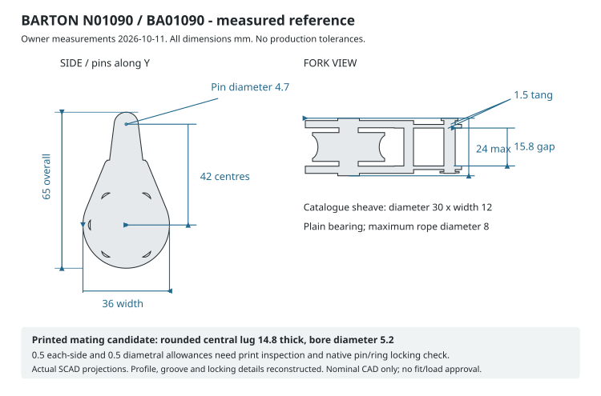

# Received Barton N01090 top positioning-line pulley

Owner measurements and photographs, 11 October 2026. The four already-collected
WASI BA01090 units are the **Barton N01090 Series 1 plain-bearing double-tang
block**. The ball-bearing N11090 is a separate article. Purchase quantity,
WASI unit price and collection evidence remain unchanged in the
[dated purchase record](../../../bom/sourcing/wasi-pulley-2026-10-08.md).

## Dimensions

| Received sample measurement | Owner-reported value |
| --- | ---: |
| Overall length × body width × maximum thickness | 65 × 36 × 24 mm |
| Supplied clevis pin diameter | 4.7 mm |
| Clear gap between tangs | 15.8 mm |
| Thickness of each tang | 1.5 mm |
| Clevis-pin centre to sheave-axle centre | 42 mm |

The [full evidence record](../../../bom/sourcing/barton-n01090-2026-10-11.md)
links the original [side photograph](../../../bom/sourcing/evidence/barton-n01090/side.jpg)
and [fork/pin photograph](../../../bom/sourcing/evidence/barton-n01090/fork-and-pin.jpg).
Measurement instrument, uncertainty and sample lot were not supplied; no
production tolerance follows from these values.

## Manufacturer specification

The [Barton product page](https://bartonmarine.com/catalogue/size-1-30mm-plain-bearing-pulley-block-single-double-tang/),
[range sheet](https://bartonmarine.com/wp-content/uploads/2024/04/Size-1-Block-range.pdf)
and [issue 56 catalogue](https://bartonmarine.com/wp-content/uploads/2025/10/Barton-Catalogue-issue-56-full-publication-1.pdf)
(printed pages 12–13) identify a 30 × 12 mm sheave, maximum 8 mm rope, acetal
sheave on a brass plain bearing, glass-reinforced nylon cheeks and an internal
stainless frame. Manufacturer SWL is 355 kg and breaking load 710 kg, for the
block alone. Mass is 47 g in the catalogue /48 g on the page; not weighed here.

Catalogue length 65 mm agrees with the owner. Web-listed 66 × 32 × 25 mm does
not describe the measured sample envelope. The owner dimensions govern this
reference model. No public manufacturer dimensioned drawing or CAD file was
found in the searched product/range/catalogue sources.

## CAD and mounting

The registered [block source](../../../hardware/assemblies/corner-station/top-positioning-line-pulley.scad)
and [shared library](../../../hardware/lib/barton-size-1-block.scad) are r1.0.0.
The sheave axle is the origin; +Z points to the clevis; Y is both pin axes.
Measured overall/interface dimensions drive the model. Cheek detail, groove,
rivets, usable pin length and retaining ring are reconstructed surfaces.

Both r1.0.0 printed carrier halves use a rounded **14.8 mm central lug** with
**5.2 mm bore**, leaving provisional 0.5 mm each-side /0.5 mm diametral allowance.
Use the native **4.7 mm pin and locking ring** after checking printed fit and
positive engagement. For direct mounting, reprint both carrier halves; pads, covers, template and
WT-806 clamp solids retain their existing fabrication geometry. Do not substitute
an M8 pulley pin or enlarge factory holes.

Already fabricated r0.1.0 halves can use the proposed
[temporary socket adapter](../../../hardware/assemblies/corner-station/legacy-pulley-adapter.md)
for unloaded fit and hand-routing trials while replacements are made. It uses
an M8 bolt only at the old carrier and the supplied pin at a separate lower
lug; its 35 mm lower sheave position and unqualified physical behavior are
documented separately.

Measured 42 mm spacing changes the nominal 45° equal-tension pose while retaining
the winch tangent: pin offset from post surface 147.8515 mm passive /146.9515 mm
powered, pin Z165, sheave Z135.3015. Actual groove seating and changing line
angles still need installed checks. The collar alternative uses the same central
lug; the keeper is only a nominal guard candidate and is not installed in the
printed-head package.

See the [nominal checks](barton-geometry-check.md),
[design package](design-package.md) and [acceptance record](acceptance-record.md).
All remain **concept-unvalidated**. Owner dimensions and mesh clearance do not
establish print strength/creep, pin locking, thin-line retention, friction or
loaded operation.
