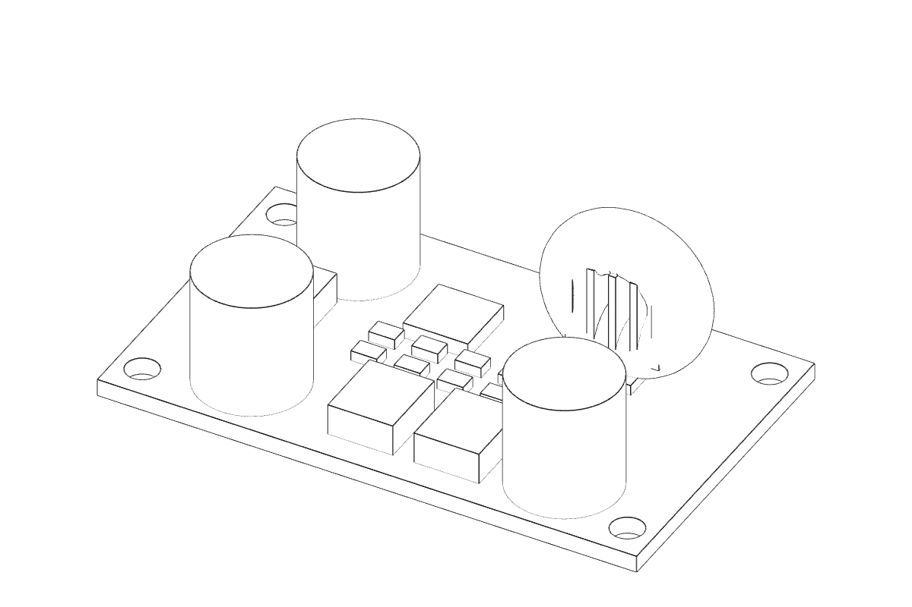
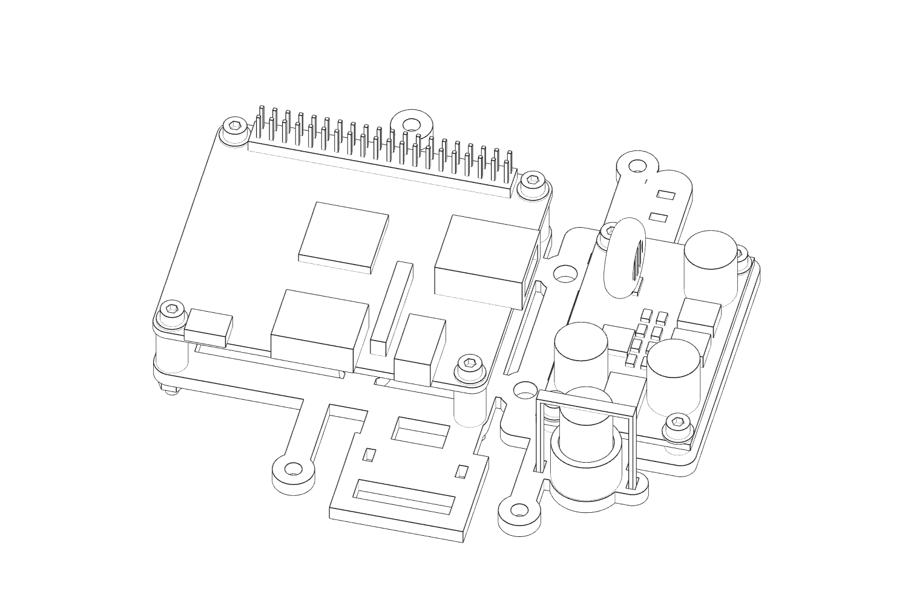
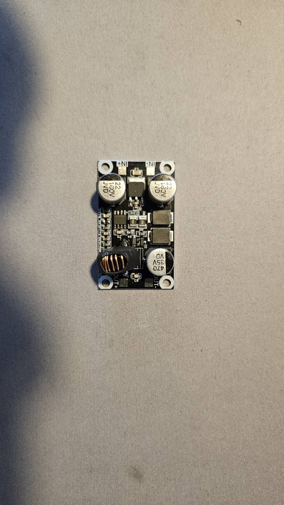
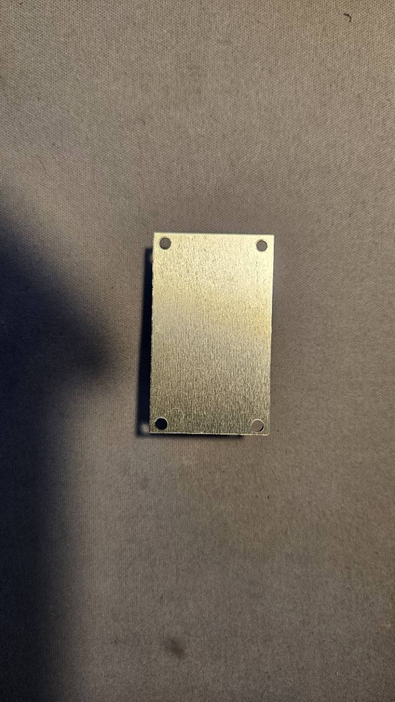
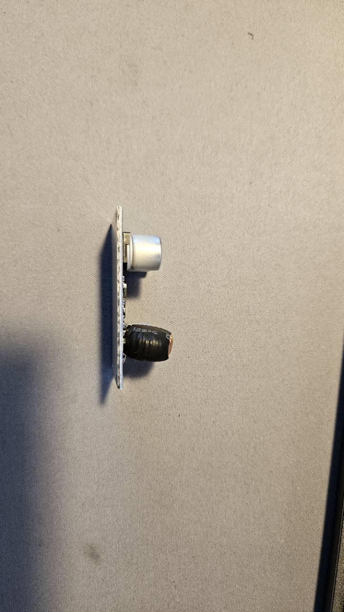

# Received fixed-5 V buck converter — 12 October 2026

The owner confirmed receipt of the **5 V variant** from [AliExpress item
1005007014032926](https://www.aliexpress.com/item/1005007014032926.html), supplied
the three photographs below, and reported the dimensions in this record. The
same selected module is used under the separate pod and cabinet BOM identities.
This is receipt and owner-reported dimensional evidence, not an electrical test
or independent fit inspection. The measurement instrument and uncertainty were
not supplied.

## Measured geometry

| Feature | Owner-reported value |
| --- | --- |
| Board length × width | 50 × 30 mm |
| Overall tallest occupied height | 17 mm |
| Four mounting-hole diameters | 3 mm |
| Hole centre pitch, along length × width | 45 × 24 mm; explicitly confirmed centre-to-centre |
| Derived centre inset from the short ends / long sides | 2.5 / 3 mm |
| Derived gap from hole edge to PCB edge | 1 / 1.5 mm |
| Received variant | Fixed 5 V; owner reported no other purchase options |

The shared [canonical reference](../../hardware/lib/buck-converter-48v-5v.scad)
has its origin at the centre of the underside, X along the 50 mm side, input at
−X, output at +X and populated face toward +Z. Hole centres are
[−22.5,−12], [−22.5,12], [22.5,−12] and [22.5,12] mm. The top-view photograph
shows IN+/IN− solder pads at the input end and OUT+/OUT− at the output end;
there are no fitted screw terminals. Pad locations and sizes are photo-derived
reference envelopes, not measured connection coordinates. Verify the actual
silkscreen before wiring.

## Remaining dimensional and electrical limits

PCB/underside stack thickness is **nominal 1.6 mm**. The flat metallic underside
is represented within that thickness; its material, thickness, attachment and
electrical potential are unknown. Capacitor, inductor, power-device, pad and
small-component dimensions are simplified from the photographs and clipped to
the reported 50 × 30 × 17 mm overall envelope. Component detail is not a
supplier-certified model. There is no measured wire diameter, bend radius,
solder-joint projection, mass or fastener stack yet.

The source listing could not be retrieved through the web tool, and browser
security policy blocked opening it. Its current input limits, variant-specific
continuous current, efficiency, derating, cooling and operating temperatures
were not verified. Visible capacitor markings do not establish the module's
ratings. The existing ≥60 V input, 48 V nominal distribution and pod ≥3 A output
remain requirements; receipt of a 5 V variant does not demonstrate compliance.
No price, stock, VAT or commercial observation was refreshed.

## Mounting and affected assemblies

The pod's [compact deck](../../hardware/assemblies/camera-pod/camera-pod-integrated-deck.scad)
r0.1.1 and explicit alternative [dry deck](../../hardware/assemblies/camera-pod/camera-pod-electronics-deck.scad)
r0.1.2 replace assumed converter ties with four 2 mm support pads and Ø2.9 mm
M2.5 clearance bores. The board underside stays at Z=22.5 mm, giving a measured
converter envelope top at Z=39.5 mm. Four nominal M2.5 × 10 screws, eight Ø6 ×
0.5 mm washers and four 2 mm plain nuts retain the nominal PCB stack. Install
the converter on the separate deck before the enclosure/tray obstructs the
underside nuts. The compact converter centre is [35,0]; the dry bench centre is [46,0], shifted 6 mm outward to clear the frame clamps. Orient input toward −Y in the compact pod and −X at the bench.

The [cabinet reference](../../hardware/assemblies/control-cabinet/control-cabinet-assembly.scad)
r0.1.2 uses the same module at X=−150, Z=55, with four 7 mm insulating sleeves,
four M2.5 × 16 screws, eight washers and four plain nuts through the proposed
2 mm plate. The plate's converter bores follow the measured 45 × 24 mm pattern.
This is a nominal mounting reference; actual enclosure/plate dimensions and
electrical isolation still need inspection before fabrication or installation.

Keep solder pads exposed, route input/output wires away from the screw heads
and populated face, provide separate strain relief, and inspect required
insulation against the metallic underside. The reference reserves vertical
solder-pad access, not a verified flexible harness or cooling passage.

The [source/checksum inspection record](buck-converter-cad-2026-10-12.json) records the following CAD-only results for these revisions.

| Check | Result |
| --- | --- |
| Complete CAD registry | 162 entrypoints compile with OpenSCAD 2021.01 |
| Both pod configurations | Zero neutral collisions; 555 sampled motion poses each, no unintended collisions |
| Entire measured envelope | 50 × 30 × 17 mm clears neighbouring geometry and each cover; own mounting hardware excluded from the occupied-volume probe |
| Converter mounts and service | Four PCB/support bores, screw insertion, vertical removal, four drivers and four solder-pad access envelopes pass in each pod |
| Regression controls | Original converter positions collide with frame nuts; one-millimetre misplaced hole/screw probes detect interference |
| Cabinet | Matching pod/cabinet reference meshes; mounted converter clears plate and represented Pico/terminal/ground/field neighbours |
| Booklets | Enclosure revision 6: 16 A4 pages/44 meshes; bench revision 5: 14 A4 pages/41 meshes; pages visually reviewed and source/ZIP checks pass |

Reproduce with the repository-pinned OpenSCAD on PATH and the [booklet Python dependencies](../../scripts/winch-booklet/requirements.txt):

```sh
python3 scripts/check-buck-converter.py
python3 scripts/camera-pod-booklet/build.py --enclosure --output hardware/generated/converter-pod-enclosure
python3 scripts/camera-pod-booklet/build.py --output hardware/generated/converter-pod-bench
```

These are source/nominal-mesh results. Physical assembly, PCB thickness, soldered wire routing, electrical ratings and cooling remain unverified.
Earlier dated collision/mass records and booklet snapshots describe their
original revisions and are retained as historical evidence.

## Current CAD illustrations

These two figures render the checked STL geometry. They show the measured
envelope and holes with nominal component and fastener detail; they are not
photographs or manufacturing drawings. The compact converter is centred at
X=35, Y=0 after the 3 mm shift needed to clear the existing frame nuts.





## Received-unit photographs






