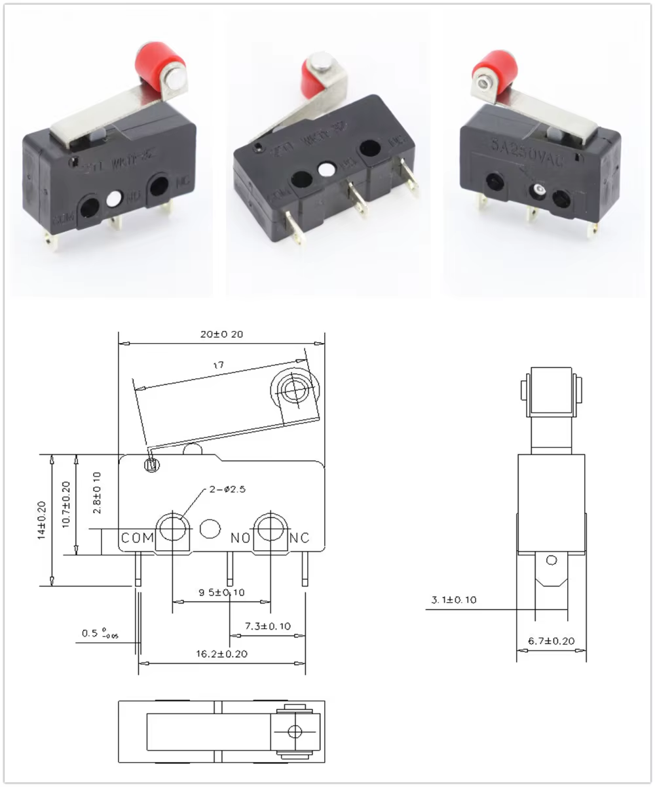

# Received KW11-3Z roller microswitch — 12 October 2026

Aleks confirmed receipt of the **KW11-3Z** variant ordered from AliExpress,
supplied the listing's dimensioned illustration below, and reported the physical
measurements in this record. The current offer maps to [AliExpress item
32273125391](https://www.aliexpress.com/item/32273125391.html); the supplied
illustration is retained as owner-provided supplier material, not a newly
verified listing or manufacturer-certified drawing. Received quantity, delivery
date, measurement instrument and uncertainty were not supplied. No commercial
observation or electrical qualification was refreshed.

## Dimension basis

| Feature | Value | Evidence |
| --- | --- | --- |
| Received variant | KW11-3Z | Owner confirmation |
| Case length × height × thickness | 20 × 10.7 × 6.7 mm; each ±0.20 mm | Supplied drawing |
| Two mounting bores | Ø2.5 mm | Supplied drawing |
| Bore centre pitch / height above case bottom | 9.5 ±0.10 / 2.8 ±0.10 mm | Supplied drawing |
| Left case edge to first bore centre | 5.5 mm | Owner measurement |
| Derived second bore centre from left edge | 15.0 mm | 5.5 mm measurement + 9.5 mm drawing pitch |
| Roller diameter / width | 4.8 / 4.0 mm | Owner measurements |
| Overall axle-end width | 7.2 mm | Owner measurement |
| Lever width / thickness | 4.0 / 0.3 mm | Owner measurements |
| Released roller-top height | 21.0 mm above case bottom | Owner measurement, corrected to 21 mm; explicit datum confirmation |
| Electrical click on pressing | Approximately 18 mm above case bottom | Owner measurement |
| Fully pressed roller-top height | 16 mm above case bottom | Owner measurement; explicitly fully pressed, not the click point |
| Case top to terminal tips | 14 ±0.20 mm | Supplied drawing; lever excluded |
| Terminal blade width / thickness | 3.1 ±0.10 / nominal 0.5 mm | Supplied drawing; thickness tolerance not transcribed |
| First-to-last / middle-to-last terminal pitch | 16.2 ±0.20 / 7.3 ±0.10 mm | Supplied drawing |
| Lever length callout | 17 mm | Supplied drawing; endpoint/pivot interpretation remains approximate |

The hole pair is not assumed centred: the current centres are X=5.5 and 15.0,
Z=2.8 mm. The nominal 5 mm roller-top descent between the released and fully
pressed measurements is a geometric endpoint difference, not rated operating
travel. Likewise, the approximately 2 mm descent from click to fully pressed
does not establish allowable overtravel or a recommended cam stroke. Electrical
release position, hysteresis, operating force and manufacturer-rated overtravel
remain unknown.

## Canonical model and remaining uncertainty

The [canonical visualization](../../hardware/assemblies/winch/roller-lever-microswitch.scad)
r1.0.0 replaces the assumed KW12-class block. Its origin is the left case edge,
case thickness midplane and case bottom. X follows the case length, Y passes
through the mounting bores and roller axle, and Z points upward. The case spans
X=0..20, Y=−3.35..3.35 and Z=0..10.7 mm; terminals extend to Z=−3.3 mm.

The default `pose="released"` export uses the 21.0 mm height. Other inspection
poses are `pose="clicked"` (approximately 18 mm) and `pose="fully-pressed"`
(16 mm). `part="case"`, `"roller"`, `"lever"` or `"terminals"` exposes the
reference subparts. These are inspection options on the same entrypoint, not
additional public release artifacts.

The lever is shown as a rigid straight strip with simplified bent ears. The
anchor X=3.2 mm, roller reach 15.3 mm along the strip, axle lift 2.4 mm, axle
diameter 1.6 mm and centred terminal span are **approximate reference details**.
Lever angles are solved to match the reported roller-top heights; the supplied
drawing's depicted angle is not treated as a measured rest angle. Horizontal
roller-centre positions, true attachment/pivot geometry, spring flex, bends,
case moulding, axle detail and terminal openings remain unmeasured. These poses
do not establish the swept path, cam contact point, contact forces or clearances
throughout motion. Measure the attachment and roller centres relative to the
case before final target/bracket design.

The registry retains `geometry.status="approximate"` and
`status="concept-unvalidated"` because the complete occupied envelope and
moving interface are not yet measured. Receipt and owner measurements do not
establish mounting fit, electrical behaviour beyond the approximate reported
click, weather resistance, endurance, or installed winch/dock acceptance.

## Reproducible CAD inspection

Use the registry-pinned OpenSCAD 2021.01 on PATH and the existing
[booklet Python dependencies](../../scripts/winch-booklet/requirements.txt):

```sh
python3 scripts/check-microswitch.py
pnpm cad:check -- --require-openscad
pnpm bom:check
pnpm docs:check
git diff --check
```

The [mesh inspection script](../../scripts/check-microswitch.py) exports the
case, roller and full switch at each pose; checks the case envelope, roller
diameter/width, axle span and roller-top heights; probes both mounting bores;
and requires a deliberately displaced mounting probe to detect interference.
Inspection meshes and `check.json` go under ignored
`hardware/generated/kw11-3z-check`. These checks verify source geometry against
the recorded dimensions, not received-unit or installed performance.

The [13 October source/hash inspection record](kw11-3z-cad-2026-10-13.json)
records passing checks for r1.0.0: both through-probes clear, both 0.5 mm shifted
probes detect interference, and the three exported roller-top heights match
21.0 / approximately 18 / 16 mm within 0.003 mm tessellation tolerance. This
tolerance belongs to the CAD check; it is not a physical measurement uncertainty.

The owning volume capture exported all 73 fabrication meshes with the pinned
OpenSCAD compiler; their recorded volumes are unchanged. `pnpm bom:generate`
and `pnpm bom:check` passed after refreshing the source hashes and STL checksums.
The reports now carry the corrected KW11-3Z specifications. This is nominal
source/mesh evidence, not physical acceptance.

## Supplied illustration

This image combines listing photographs and a dimensioned drawing. It is not a
photograph of the received unit.


