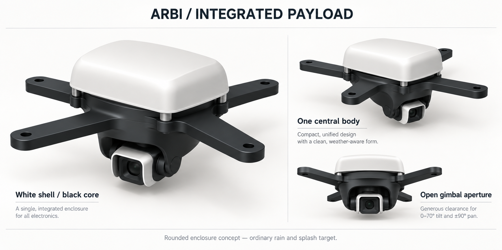
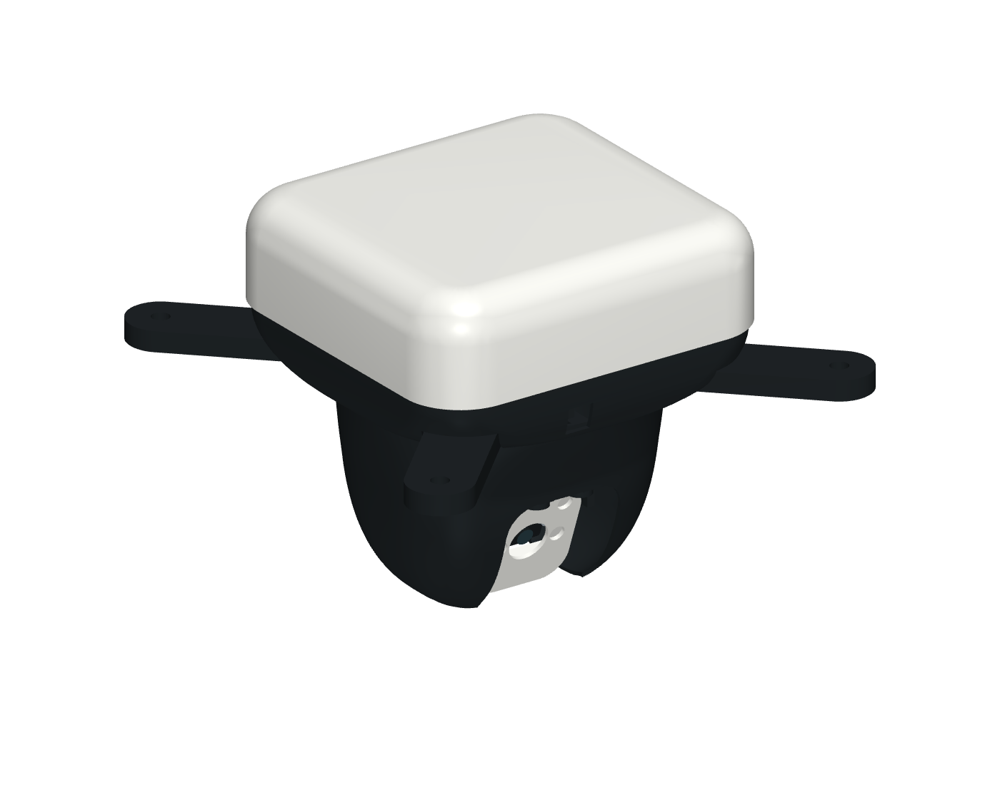

# Compact integrated camera pod rain enclosure r0.4.0

> **Critical — temporary cable-tie retention.** The converter now uses four screw stacks; remaining capacitor and harness ties are bench workarounds only. Dedicated capacitor retention and harness strain relief remain unresolved; see the [prioritized BOM warnings](../../../bom/README.md#warning-priorities). Historical CAD/check records preserve the inspected tie-based configuration, not final acceptance.

This is the compact rounded black/white appearance configuration for the [camera pod mount family](camera-pod-mounts.md). It is designed to reduce ordinary rain and splash exposure of the fixed Pi/power electronics, both servo bodies, and the camera rear connector. All models remain **concept-unvalidated**. The shell has downward openings, drainage, an open gimbal aperture and exposed moving interfaces; it has no ingress rating. It does not change the [weather operating policy](../../../docs/operations/weather-parking-and-maintenance.md), dock shelter requirement or physical flight acceptance gates.

The selected illustration records the appearance direction: one rounded white upper body, a black lower core, and a small white moving optical surround. [ADR-0009](../../../docs/decisions/0009-compact-integrated-camera-pod.md) records the compact packaging decision and its preserved interfaces, accepted as the design direction on merge with physical validation pending. The illustration is an appearance reference, not a dimensioned CAD render or proof of clearance. The [earlier alternatives](../../../docs/assemblies/camera-pod/enclosure/concepts.png) are retained for design history. The canonical fixed-shell geometry is [camera-pod-enclosure.scad](../../lib/camera-pod-enclosure.scad); [camera-pod-integrated-head.scad](../../lib/camera-pod-integrated-head.scad) defines the one-piece moving outer head, and [camera-pod-integrated-gimbal.scad](../../lib/camera-pod-integrated-gimbal.scad) defines its compact internal carrier, camera cradle and opposite pivot support. [camera-pod-assembly.scad](camera-pod-assembly.scad) r0.4.0 is their assembled reference. The fixed electronics use the separate [integrated deck](../../lib/camera-pod-integrated-deck.scad).

The following committed images show the earlier r0.3.7 appearance and Standard
camera reference. Use the current release/booklet for Wide and hood r0.2.0;
these images do not establish its fit.

The [underside](../../../docs/assemblies/camera-pod/enclosure/compact-underside-cad.png), [bottom](../../../docs/assemblies/camera-pod/enclosure/compact-bottom-cad.png) and [pan 90° underside](../../../docs/assemblies/camera-pod/enclosure/compact-underside-pan90-cad.png) views show the tray/head clearance seam during operation. The actual CAD preview and [front view](../../../docs/assemblies/camera-pod/enclosure/compact-front-cad.png) show the compact configuration at pan 0°, tilt 70°. The [neutral](../../../docs/assemblies/camera-pod/enclosure/compact-neutral-cad.png) and [open electronics](../../../docs/assemblies/camera-pod/enclosure/compact-electronics-cad.png) views use the same meshes at tilt 0°. The generated `product-eye-aligned` diagnostic looks along the lens axis at tilt 70° with the full assembly retained; `preview-manifest.json` records each view's pose, viewing direction and part transforms. The booklet's line-art covered view remains at tilt 55°. The [check record](camera-pod-enclosure-check.md) and [machine-readable results](camera-pod-enclosure-check.json) identify the inspected revisions. The [historical record](camera-pod-enclosure-check-r0.1.0.md) preserves the earlier elongated enclosure.

## Stock fastener revision, 15 October 2026

[Proposal #225](https://github.com/gredice/arbi/issues/225) standardizes the compact kit for M3 screws no longer than 25 mm and M2 × 8 board screws. The [joint design and complete inventory](../../../docs/assemblies/camera-pod/fastener-standardization.md) own the new stack details. The deck integrates the four former spacers; PCB holes, board heights and optical datums stay unchanged. This local design revision needs the new nominal CAD checks and a physical reprint/hardware inspection. Earlier CAD records and publications apply only to their stated revisions.

## Configuration and print quantities

Choose either the dry bench arrangement or the compact enclosure arrangement below. **Do not install the dry deck, cover, optical hood, pan yoke, cradle or pivot support, or the earlier fixed fairing, servo boot or rear camera cowl, in this compact kit.** Its one-piece outer head surrounds a separate compact carrier; both move in pan. The new cradle and pivot support place the camera higher inside that head. The white optical surround retains its existing geometry and camera mounting pattern. The original `camera-pod-*` concept gimbal is a separate family.

| Model | Revision | Per enclosed pod | Suggested colour | Change from the dry bench set |
| --- | --- | ---: | --- | --- |
| `camera-pod-spider` | 0.1.0 | 1 | Black | Reuse; no geometry change |
| `camera-pod-integrated-deck` | 0.2.0 | 1 | Black | Reprint for stock fastener revision |
| `camera-pod-pan-servo-mount` | 0.1.1 | 1 | Black | Reprint for 25 mm servo pitch |
| `camera-pod-integrated-gimbal-carrier` | 0.2.0 | 1 | Black | Reprint for stock fastener revision |
| `camera-pod-integrated-gimbal-head` | 0.2.0 | 1 | Black | Reprint for stock fastener revision |
| `camera-pod-integrated-camera-cradle` | 0.2.0 | 1 | Black | Reprint for stock fastener revision |
| `camera-pod-integrated-tilt-pivot-support` | 0.2.0 | 1 | Black | Reprint for stock fastener revision |
| `camera-pod-horn-retainer` | 0.1.0 | 2 | Black | Reuse |
| `camera-pod-integrated-camera-hood` | 0.2.0 | 1 | White | Reprint open-rear Wide seat with 13.6 mm rounded-square opening; replaces dry hood |
| `camera-pod-rain-hood` | 0.3.0 | 1 | White | Reprint for stock fastener revision |
| `camera-pod-enclosure-base` | 0.2.3 | 1 | Black | Reprint rolled underside shoulder with a circular clearance throat |

This is 12 installed printed pieces from 11 installed model types. The 12th exported fabrication model, `camera-pod-servo-fit-coupon`, is an optional test print and is not installed. `camera-pod-assembly` is a reference CSG, not a print part. The stable BOM owners remain [camera-pod-chassis](../../../bom/generated/parts/camera-pod-chassis.md) and [camera-gimbal](../../../bom/generated/parts/camera-gimbal.md); their fabrication-source lists include only the current compact kit. Superseded concept parts, dry bench alternatives and retired shields are archived separately in the registry and excluded from current BOM mappings and individual fabrication downloads.

For the stock fastener revision, reprint the integrated deck, carrier, head, cradle, opposite support and white optical hood at r0.2.0, plus the rain hood at r0.3.0. Omit the four loose spider spacers. Reuse the spider, pan mount, horn retainers, tray r0.2.3. Keep earlier gimbal/cowl and dry-bench parts out of this kit. The assembled reference is `camera-pod-assembly` r0.4.0.

The new shell walls start at 1.2 mm. ASA remains the preferred exposed-release material and PETG is a prototype starting point; neither material/colour choice establishes UV resistance, creep performance, water resistance or thermal acceptance. Slice the complete chosen quantities with the intended nozzle, walls, layers and supports, inspect thin walls and bridging, and weigh the printed assembly. Keep support scars away from mating lips, nut pockets, horn pockets and pivot bores. Print orientation and removable-support access need slicer review before manufacture.

## Fixed body and attachment interfaces

Coordinates below use millimetres in the spider-centred assembly frame: Z points toward the dock and the spider line plane is Z=0. Moving-part coordinates and staged service use neutral pan=0°, tilt=0° unless a check explicitly states another pose. Nominal rigid CAD checks do not establish received-part or flexible-harness fitting.

- Upper hood: 124 × 118 mm plan envelope centred at X=0, Y=0, with 20 mm plan corner radius, lower edge Z=14.8 and roof Z=49.5. A 14 mm rolled shoulder replaces the earlier straight chamfer. Its roof has no intended screw openings.
- Compact electronics: Pi centre [-22, 0], with its unchanged 58 × 49 mm mounting pitch; converter centre [35, 0], turned 90° in plan; capacitor centre [32, -34]. The fixed frame interfaces, deck Z=17.5–20.5 and Pi board underside Z=30.5 remain unchanged. The received converter envelope is 50 × 30 × 17 mm with four Ø3 mm holes at 45 × 24 mm pitch. Deck r0.2.0 supports its screw axes at X=23/47, Y=±22.5; four M2 × 8 stacks with recessed lower M2 washer/nut seats replace ties. Board underside Z=22.5 and envelope top Z=39.5 are retained. PCB/component detail, installed fit and the capacitor remain nominal; see the [received-unit record](../../../docs/evidence/buck-converter-2026-10-12.md).
- Upper rain tray: 120.8 × 114.8 mm plan envelope; floor Z=13.2–14.4. Its raised lip overlaps inside the fixed upper hood. Revision 0.2.3 replaces the exposed flat underside/skirt with a rolled shoulder ending at Z=-6.1 in a nominal Ø103 mm circular throat. The moving head has a Ø100 mm neck at Z=-4.1, giving 2 mm axial overlap and 1.5 mm nominal radial clearance. The actual faceted STL clearance is recorded in the geometry check. Four open-bottom 23.2 mm arm reliefs preserve the unchanged spider and upward tray removal. Recessed screw access, CSI access, the rear power breakout and both drains remain open. The new moving head attaches to its internal carrier instead of the tray.
- Hood, compact deck and tray share four M3 axes at X=-22 and 22, Y=-46 and 46, in the fore/aft gaps between the spider arms so a driver can approach from below. Four M3 × 25 bolts enter from underneath, each with one washer at Z=12.7, and engage plain M3 nuts captured in side-loaded pockets at Z=34. Nominal screw tips reach Z=37.7; the represented 2.4 mm nut leaves 1.3 mm tip protrusion. Roof clearance must be evaluated at each screw and nut against the curved shoulder, not the maximum centre roof height. The nut slots face inward for installation with the hood off. No threads depend on printed plastic. Check actual washer, nut and bolt dimensions, nut insertion access, thread engagement and roof clearance before tightening.
- Moving lower head: r0.1.5 combines the Wide optical opening with main's measured-servo clearance and widens the tapered X radius from 47 to 49.5 mm for the received servo rear envelope, retaining the Ø100 mm neck and 1.2 mm nominal wall. It blends the circular neck into the wider tapered profile over the first 28 mm below Z=-4.1. The lower camera opening is now 48 × 54 mm for Wide rays; the upper/front opening and four carrier clamp axes remain unchanged. The [servo fit correction](../../../docs/evidence/micro-servo-2026-10-12.md) also requires pan mount/coupon r0.1.1 and compact carrier r0.1.2. The owner accepted the revised servo fit; inspect those prints during assembly. Its neck sits inside the fixed shoulder so the underside reads as one continuous charcoal body with a narrow clearance seam. Both parts remain separate and removable. The [reconciled Wide record](../../../docs/evidence/camera-module-3-wide-2026-10-14.md) owns current nominal fit/travel results; the [servo CAD record](../../../docs/evidence/micro-servo-cad-2026-10-12.json) records the preceding Standard-camera configuration; the earlier [geometry record](camera-pod-enclosure-check.md) describes its original revisions. The head and carrier rotate together through nominal pan ±90°; the camera tilts inside the front/underside opening.
- Compact gimbal: tilt axis Y=3, Z=-45, placing the camera 14 mm higher than the preceding arrangement. The tilt servo turns 90° about X into a horizontal orientation and moves 2 mm inboard; the driven horn interface is at X=-19.8. The integrated cradle, carrier and opposite pivot support implement this arrangement. Camera screws remain M2; the existing M3 opposite pivot is retained.
- The tray fits around the integral deck posts and unchanged Pi axes X=-51 and 7, Y=±24.5. The posts extend from Z=3.5 to 17.5; frame M3 washers occupy Z=12.7–13.2 and nuts Z=13.2–15.6 inside side-loaded pockets. Four M3 × 25 screws enter at Z=-7 from below; tips reach Z=18. Pi M2 × 8 screws enter at Z=32.4 into post nuts at Z=25.5–27.1 and washers at Z=27.1–27.4. The converter M2 × 8 screws enter at Z=24.4, with lower washers Z=19.1–19.4 and nuts Z=17.5–19.1. The [stock fastener list](../../../docs/assemblies/camera-pod/fastener-standardization.md) supersedes the dry mount hardware for this kit. The shell does not resolve load-rated line termination or the docking interface.

## Moving head, assembly and service

The outer head and carrier are separate r0.2.0 prints. Four M3 × 12 screws, eight M3 washers and four plain M3 nuts join them at X=±8, Y=±30.5. Screws enter downward from Z=-28.7 with upper washers at Z=-29.2–-28.7. Each Ø10.4 mm head boss extends from Z=-38.5 to -31.7. Load the lower washer into Z=-35.2–-34.7 and the nut into its Z=-37.8–-35.2 pocket through the inward-facing channel before fitting the carrier. Nominal nuts occupy Z=-37.6–-35.2; screw tips reach Z=-40.7. The captive pocket removes the hidden-wrench requirement. Inspect actual heads, seats, engagement and tip clearance before tightening.

The nominal staged sequence is:

1. Secure the spider and fixed pan mount independently on a bench fixture. Populate the separate carrier outside the outer head. Attach the carrier to the stock pan horn and fit the pan OEM centre screw before installing the camera. On the bench, fasten the stock tilt horn and retainer to the separate cradle before engaging the mounted tilt servo; the servo case blocks the rear retainer driver after spline engagement. Seat the cradle on the servo, secure the tilt OEM centre screw, then slide the opposite pivot support inward along -X from a position 12 mm to its right. Secure the support and existing M3 pivot before fitting the camera and optical hood. An upward support-installation path collides with the compact geometry.
2. Preload all four lower washer/nut pairs into the head. At neutral pan/tilt, raise the head over the complete gimbal, then fit its four screws and upper washers from above. Complete these clamps before the upper tray and electronics stack obstruct access.
3. Preload the frame M3 and Pi M2 washer/nut pairs in their inward-facing deck slots. Fit the converter lower hardware into its bottom recesses, then mount both boards on the separate deck. Fit the tray and loaded deck above the spider without loose spacers. Tighten the four frame M3 × 25 screws from below. Fit the hood's captive M3 nuts, route the harness and close the hood last.
4. For service, isolate power and release or feed the harness. With the spider and fixed pan mount independently supported, remove the upper hood, electronics/deck/tray and relevant frame stacks to expose the head clamps. At neutral, remove the four head screws and upper washers, then lower the head 100 mm with its captive lower washers/nuts while the carrier stays supported. The nominal top approach uses an 80 mm straight driver; inspect the actual handle and fixture.
5. With the head off, remove the camera's four rear screws and lower the camera, white hood and captive front nuts 30 mm. The open cradle then admits the nominal 65 mm OEM driver before the centre screw and supported carrier can be removed. The compact kit has no separate cowl-removal stage.

The [service record](camera-pod-enclosure-check.md) owns the tested staged paths and their prerequisites. Reverse the checked sequence for assembly. A clear rigid path does not prove removal around attached leads or establish a suitable support fixture. Inspect cable slack and disconnect the isolated harness where necessary; do not pull the enclosure against retained wiring. The upper lip, moving neck and optical opening are rain-shield details, not seals.

The compact camera stack uses **four M2 × 8 rear screws and four captive front M2 nuts, without camera washers**. Rear Ø4.2 mm head recesses start at canonical cradle Z=-61; front hood nuts occupy Z=-68.12–-66.52 in that frame. Both metal bearing faces contact printed seats rather than the PCB. The reversed joints avoid larger rear nut/washer seats crowding the CSI connector. Preload the front nuts in the white hood, seat the camera flat, then offer the pair to the cradle and fit rear screws. Inspect actual heads, nut seating, thread projection and even PCB support. The kit has no separate rear cowl or secondary camera nuts.

The white `camera-pod-integrated-camera-hood` r0.2.0 retains the 34 ×36 mm eye outline, four M2 axes and installed PCB plane. The cavity is 29.4 ×28.2 mm, flaring to 31 ×30 mm at its rear rim. The walls end at local Z=6, 3.4 mm below the exposed PCB seating lands at Z=9.4; outside gussets support the unchanged PCB seating datum; the new cradle recesses shorten the clamp stack. A 13.6 mm rounded-square front opening sits between four front M2 nut tunnels, each 4.4 mm across flats. Inspect the printed webs and nut seating; the former round washer tunnels are superseded. The CSI edge is open above the front rim for cable/latch access. These are ARBI handling/print allowances, not measured camera tolerances.

Reprint P09 r0.2.0 for its front captive-nut tunnels; it retains the previous hood-fit correction. With power disconnected, support the loose hood by its rim with the rear facing up and at least 3 mm free space below the lens opening, lower the camera lens-first from its open rear, and align the board flat before it reaches the four seats. Keep the CSI connector at the open edge. Check that all four PCB holes rest on their lands and connect the ribbon while accessible. With the horn centre screw and opposite pivot support secured, offer the seated camera/hood to the cradle and fit the four M2 ×8 rear screws and four front captive nuts. Tighten evenly without bending the board. No PCB corner belongs beneath a land. See the [new photo-driven fit record](../../../docs/evidence/camera-cover-assembly-2026-10-14.md) and enclosure booklet revision 10 for the revised fasteners.

Nominal software travel remains pan ±90° and tilt 0–70°; the mechanical range used for checks is pan ±95° and tilt -5–75°. Establish physical limits inside the measured cable and collision envelope. The outer head now adds mass and inertia to the pan group. Recheck servo torque, horn/fastener loads, current, backlash and settling with the complete printed assembly; a clear CAD sweep does not establish those physical limits.

## Reinforced cradle and print orientation

The earlier cradle r0.1.1 replaced the two narrow horn-plate/frame connections with broad ties, two 45-degree back ribs and a sloped web beneath the long frame edge. It retains the 41.6 × 32 × 25 mm envelope, camera bolt axes, stock horn recess, opposite pivot, central service opening and existing fasteners. The current r0.2.0 adds recessed rear fasteners and connected upper bosses; it requires a new reprint inspection. The reported r0.1.0 break during removal of support under the large bridge motivates the change; the new revision still requires a physical reprint and inspection. See the [cradle geometry record](camera-pod-camera-cradle-check.md).

For the first reprint, place the outer flat horn-plate face on the bed: rotate the canonical model −90° about Y and place its lowest face at Z=0. The plate then grows into the sloped web and ribs, avoiding a large support block attached to the two old ligaments. Inspect the slicer for the remaining open-frame bridge, camera standoffs, pocket roofs and pivot tab; apply local removable supports where needed. Use a starting profile with a 0.4 mm nozzle, 0.2 mm layers and four walls so the small ties and ribs are largely solid. Keep supports off the new junction when the slicer permits, cut them into small pieces before removal and hold the frame beside each cut. These are starting settings, not validated print parameters. Check cracks, layer adhesion, horn engagement, all washer/nut seats and the full assembled travel before use.

## Harness entry, exit and strain relief

The base provides dedicated downward outlets with collars recessed above its rounded shoulder. A 9 × 24 mm rear breakout at [10, 58], Z=-3.5–5.5 lets the incoming lead turn outward along its existing nominal route. These dimensions are nominal passage dimensions, not approved connector specifications:

| Route | Base opening and XY centre | Internal path / moving exit | Remaining measurement |
| --- | --- | --- | --- |
| Powered line to fixed converter | Ø8 mm at [10, 40] | Enter from below, turn outboard above the pan stops, form an exterior drip loop, sleeve the conductors, and secure the sleeve to the deck's separate power tie pad | Received wire/insulation diameter, bend radius, connector envelope and dielectric separation |
| Pi CSI to camera | 24 × 8 mm at [0, -48] | Aligned compact-deck passage is 18.8 × 4.8 mm; route the nominal 16 × 0.3 mm ribbon through its centre, then use separate relaxed pan/tilt loops inside the outer head to the camera connector | Actual ribbon width/thickness, end stiffener/connector size, permitted bend radius and fatigue |
| Fixed power/control to servos | 9 × 6 mm at [-40, -15] | Branch to the fixed pan servo and a separate relaxed loop to the tilt servo inside the moving head | Actual bundled leads, servo plug and case lead-exit position |

Keep mating electrical connectors inside the upper body where their measured dimensions permit; do not assume a connector fits through the narrowest slot. Route an unattached ribbon through the passages before closing its connector latches, or enlarge the parametric passage after measuring the received end. The shell does not provide glands or compressed cable seals.

Route the sleeved incoming lead clear of the moving head and full gimbal sweep. The current nominal Ø6 mm proxy follows `[10,40,24] → [10,40,1] → [10,60,1] → [10,60,-61] → [10,70,-61]`; the [geometry record](camera-pod-enclosure-check.md) owns its tested poses and collision control. These waypoints are a rigid proxy, not sharp bends to impose on a real lead. Smooth turns to the received wire's permitted bend radius, provide service slack and inspect the actual route. Earlier fixed-fairing routes do not apply.

Give the CSI ribbon and tilt-servo lead **separate relaxed pan and tilt loops**. Anchor the fixed ends on the deck, provide a pan loop to the internal carrier, then a tilt loop to the camera; keep them clear of horn pockets, servo shafts, hard stops, the optical opening and nut pockets. Use soft wraps rather than a sharp tie pressing directly on the ribbon. Verify the whole movement range with the intended harness installed, including reverse moves and service removal. Minimum bend radii and allowed twist remain received-part questions; a straight nominal routing proxy cannot establish fatigue life.

The positioning line requires an **independent tensile termination** on the spider/line interface. Conductors, connectors, deck ties and enclosure collars must not carry line tension. Downward entries and drip loops must not channel water into the converter, servo case or camera connector. Both original 6 × 2 mm downward drain slots continue through the rolled shoulder. The tray has these slots at [-30, -56] and [20, -56], straddling the lip's inner edge, and the gimbal remains open underneath; inspect that supports, debris and wiring do not block them. Their location is a drainage provision, not proof that rain cannot enter through them.

## Evidence and acceptance boundary

The [dry bench record](camera-pod-geometry-check.md) describes the separate dry configuration; the [dated 28 September record](camera-pod-geometry-check-2026-09-28.md) preserves its earlier evidence. The current [enclosure record](camera-pod-enclosure-check.md) and [machine-readable results](camera-pod-enclosure-check.json) identify the compact-gimbal revisions. The earlier Standard-camera nominal build passes 555 motion poses, all four overtravel checks, 1,566 taper sections, 41 neck-seam sections, 30 staged service paths, 22 tool envelopes, six port/drain envelopes, 15 optical poses and 111 incoming-lead poses. Oversized-neck, deliberately misplaced-lead and proud-servo-head collision controls are detected. These are sampled rigid CAD results, not physical assembly or operation evidence.

The earlier Standard/servo configuration's 16 installed prints totalled **254.516 g as a solid-volume PETG estimate at 1.27 g/cm³**, including **28.051 g for the outer head**. This excludes hardware and electronics and is not sliced or measured mass. Generate the [booklet and source/mesh pack](../../../scripts/camera-pod-booklet/README.md) into `hardware/generated/camera-pod-compact-gimbal` from these revisions. The older pack had 44 meshes; the stock-fastener build has 12 fabrication models and its own hardware inventory; the optional coupon is not installed. Earlier PDFs/ZIPs remain historical snapshots.

The owner reported **103.05 g for the earlier sliced printed parts**. Installed quantities, print settings, supports and actual printed mass have not been independently confirmed. Do not add this number to a new mesh estimate or present it as a measured flying assembly. The complete configured pod still targets **100–120 g**, with a **170 g hard design ceiling**. Weigh all installed prints, Pi, camera, servos, converter, capacitor, horns, fasteners, ribbon, wiring, insulation and any retention before assessing that ceiling.

Before claiming ordinary-rain/splash protection, record the tested part revisions, material, print settings, fitted hardware, angles, duration, water direction/intensity and inspection method. Check wet paths at the lip, nut pockets, spider passages, servo spline, lead exits, camera opening and drain slots. Record drainage and post-exposure drying/condensation. The target is a bounded rain/splash prototype; immersion, pressure washing and an ingress rating are outside this proposal.

Thermal acceptance needs temperatures with the upper shell fitted, at representative ambient conditions and camera/Wi-Fi/servo/converter loads, plus sheltered dock heat soak. White upper surfaces are an appearance/material choice and do not prove sufficient cooling. Physical fit, cable fatigue, electrical isolation, fastener retention, servo torque/settling, flying mass, balance, load capacity, dock clearance and rain/thermal behavior remain separate unverified gates after source checks.

## Wide camera fit revision

The [12 October record](../../../docs/evidence/camera-module-3-wide-2026-10-12.md)
selects Wide: 120° diagonal, 102° horizontal and 67° vertical FOV. Earlier
Standard optical reports and mass figures apply to their stated revisions.
[The reconciliation](../../../docs/evidence/camera-module-3-wide-2026-10-14.md)
tested hood r0.1.2 and assembly r0.3.9. It reported 251.734 g for sixteen prints
as a full-solid PETG estimate, excluding electronics and metal.

The owner reported repeat insertion failure on 14 October 2026. Reprint only
P09 r0.1.3 for the new low-wall, flared entrance and open CSI edge. Assembly
r0.3.10 retains the previous installed camera and hood placement. Prepare the
camera in the loose hood as described above before mounting it to the cradle.
[The new assembly-fit record](../../../docs/evidence/camera-cover-assembly-2026-10-14.md)
owns the padded/guided-loading, fastener, service and motion checks for this
revision. Physical camera seating, focal calibration, ribbon/latch service and
rain protection still require a reprint inspection.
